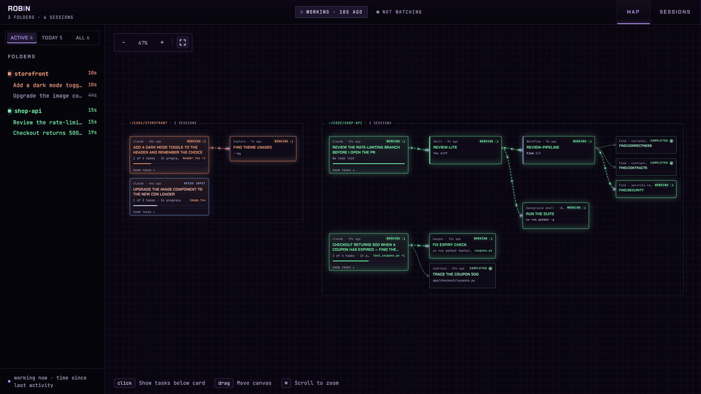
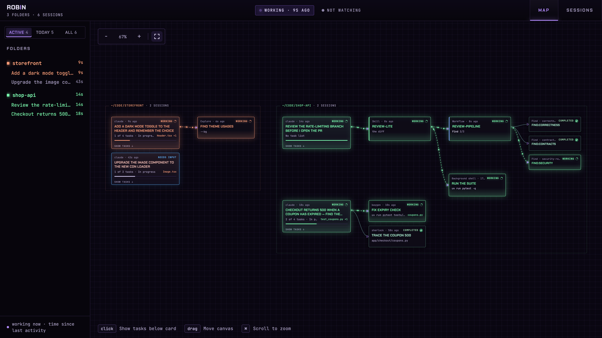
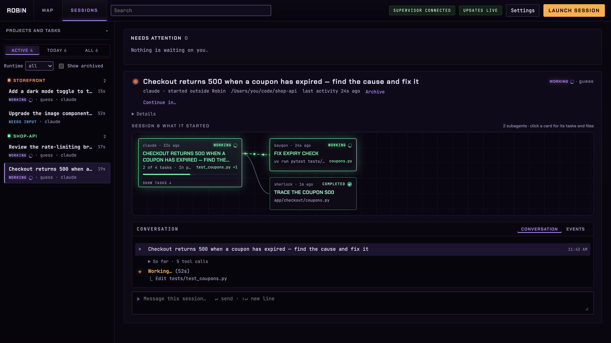
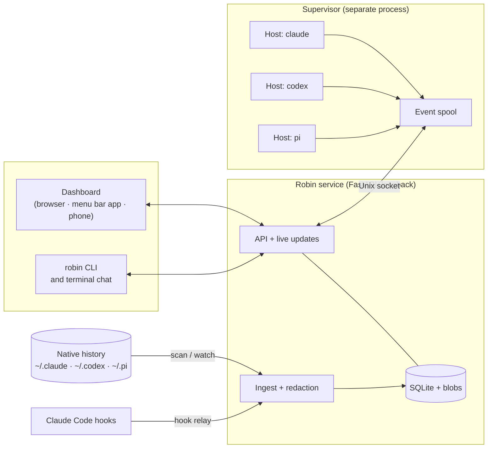

<div align="center">

# Robin

**One place to run, watch and steer your coding agents: Claude Code, Codex and Pi.**




</div>

Robin launches agent sessions under a supervisor that keeps them alive when the service restarts, indexes the sessions you already have, and lets agents working on the same task exchange findings. You choose exactly what gets shared, and preview it before it is sent. Everything runs on your machine; the dashboard listens on loopback only.

Named after Nico Robin of One Piece, the archaeologist who reads the history no one else can; the menu bar flower is her Hana Hana no Mi.

## Features

- **The Map.** Every session at once, grouped by repository, with its todo progress, the files it changed, and the skills, subagents, workflows and background shells it started, wired together as they run.
- **Sessions you already have.** `robin scan` indexes your existing Claude Code, Codex and Pi history read-only; `robin watch on` follows it as it grows.
- **Sessions that survive.** Sessions Robin launches run under a separate supervisor, so restarting or upgrading Robin never kills a running turn.
- **Answer from anywhere.** Approvals and questions from every session land in one Needs attention list: in the dashboard, the terminal chat, a macOS notification, or your phone over Tailscale.
- **Continue in another runtime.** Carry a Claude session into Codex (or the other way), with a preview of what crosses and whether it fits, before anything is written.
- **Agents that compare notes.** Agents publish findings with cited evidence; you compare them and send a reviewed, hash-confirmed context packet to another session.
- **Worktrees per session.** `--worktree` gives a session its own Git worktree and branch, so parallel agents in one repo don't edit the same files.
- **Private by default.** Secrets are redacted before anything is stored, indexed or shared. Robin never reads the runtimes' credentials.

## Screenshots

<picture>
  <source media="(prefers-color-scheme: dark)" srcset="docs/images/map-dark.png">
  <source media="(prefers-color-scheme: light)" srcset="docs/images/map-light.png">
  
</picture>

<p align="center"><sub>The Map, following your system's light or dark appearance.</sub></p>



<p align="center"><sub>Sessions: a session, what it started, and its conversation, with a message box to continue it.</sub></p>

## How it works



1. **Managed sessions** are ones Robin launches. The supervisor starts one runtime host per session and talks to it over JSON lines on stdin and stdout. Events go to an on-disk spool, and the service reads them over a user-only Unix socket with a cursor. If the service exits or crashes, it reconnects where it left off and the agents never notice.
2. **Observed sessions** are ones you started elsewhere. Robin reads their native transcripts (`robin scan`) and tails them as they grow (`robin watch on`). Ingestion checkpoints a byte offset per file, so a crash never loses or duplicates an event. Robin never changes these sessions until you send one a message, which takes it over.
3. **Hooks** are optional. `robin hooks install claude` adds a small relay to Claude Code's hooks, giving live state for sessions started in a terminal, and holding a question until you answer it from Robin.
4. **Every event is redacted** (gitleaks' rule set plus your own patterns) before it is stored in SQLite, indexed for search or shared with another agent.
5. **The dashboard** is a React app served by the service. The Map is built from what each session did: todos, file edits, skills, subagents, workflows and shells. The macOS app keeps the service running and shows the same dashboard in its own window.

More detail: [capability matrix](docs/capability-matrix.md), [threat model](docs/threat-model.md), [cross-runtime resume](docs/cross-runtime-resume.md), [benchmarks](docs/benchmarks.md), [implementation plan](docs/implementation-plan.md). Product and technical requirements are in `docs/Robin_PRD.docx` (v0.5) and `docs/Robin_Technical_Requirements.docx` (v0.4).

## Requirements

- macOS, Python 3.13, [uv](https://docs.astral.sh/uv/)
- Node.js, to build the dashboard
- Xcode, for the menu bar app
- Any of the runtimes, each signed in with its own login: `claude` (Claude Code), `codex`, `pi`. Robin never reads their credentials.

## Quick start

```bash
make sync                    # dependencies into .venv
make install                 # puts `robin` on your PATH (~/.local/bin), dashboard included
robin doctor                 # checks runtimes, storage, port and supervisor; fix anything it flags
make mac-run                 # builds the menu bar app and launches it; it starts the service for you
```

Click the robin in the menu bar → **Open Dashboard**. For Launch at Login, copy `mac/build/Build/Products/Debug/Robin.app` to `/Applications` and turn it on in the menu.

To see sessions you already have, and follow them live:

```bash
robin scan                   # index existing Claude, Codex and Pi sessions (read-only)
robin watch on               # keep following their history as it grows
robin hooks install claude   # optional: live state for sessions started in a terminal, and their questions answered from Robin
```

### Every day

Nothing to do: the menu bar app keeps the service running (the dot is green when it's up). Without the app:

```bash
robin                        # start the service and open the dashboard (or open it if already running)
robin serve --no-browser     # run the service only, e.g. in its own terminal tab
robin open                   # a fresh sign-in link for the dashboard
```

Every command except `serve` and `doctor` talks to the running service, so one of these must be running.

### After pulling or changing code

```bash
make update                  # rebuild the dashboard, reinstall robin, rebuild and relaunch the app
```

The service picks up database migrations when it starts, and the relaunch restarts it. Running agent sessions survive: the supervisor is a separate process (`robin supervisor restart` upgrades it, and refuses while turns run).

### If something's wrong

- `robin doctor` first. It names what's missing or down.
- The menu bar dot: green running, yellow starting, red failing, hollow when `robin` isn't installed (`make install`).
- Logs: `~/Library/Application Support/Robin/logs/robin.log`.
- Changes not showing in the dashboard: `make update`, then reload the window.

Robin's data lives in `~/Library/Application Support/Robin` (override with `--data` or `ROBIN_DATA_DIR`). For development without installing, prefix commands with `uv run` (`make run`, `make serve`); `make help` lists every target.

## Usage

### Start a session

From the dashboard's launch form, or:

```bash
robin run claude --prompt "Fix the failing test"          # in the current folder
robin run claude --worktree --prompt "..."                # in a new Git worktree on its own branch
robin run claude --skip-permissions --prompt "..."        # run tools without asking (claude, codex)
robin run claude --skip-permissions --chat                # then chat with it in this terminal
```

`robin run claude --skip-permissions` (or **Skip permission prompts** in the dashboard's launch form) starts a session that runs tools without asking you: Claude in `bypassPermissions` mode, Codex with approval policy `never`. Deny rules and the sandbox still apply, so `--independent` stays enforced. Pi is refused; it has no permission prompts. The choice is kept when Robin resumes or reclaims the session, and `robin open` resumes it in your terminal the same way (`claude --resume <id> --permission-mode bypassPermissions`, `codex resume <id> -a never`). Such sessions show **skip permissions** on their card and in Sessions.

`robin run --worktree` starts the session in a new Git worktree on its own `robin/...` branch, under `~/robin-worktrees` (or `ROBIN_WORKTREES`), so parallel sessions in one repository don't edit the same files. `robin worktree list` shows them; `robin worktree remove <id>` shows what removal would lose, refuses while the session runs, needs `--discard-changes` for uncommitted files, and always keeps the branch and its commits.

### Continue in another runtime

To carry a session into another runtime (the original stays as it is), preview it, then confirm:

```bash
robin continue <session> --in codex                       # what crosses, what doesn't, and whether it fits
robin continue <session> --in codex --confirm sha256:…    # write it into Codex's sessions and start it
```

Or use **Continue in…** on the session in the dashboard.

### Map

The dashboard opens on the Map: every session at once, one card per session, grouped by repository (a subfolder or worktree counts as its repository). A card shows the title (the first prompt), whether it's working, the todo list's progress and the files it changed. The floating card in the corner is the latest action anywhere. Click a card and its tasks open right below it, each with the files edited while it was in progress; from there, **Open in Sessions**, **Stop** (sessions Robin launched) or **Archive**. No projects or tasks are needed: `robin scan` and `robin watch on` are enough.

What a Claude session starts gets its own card, in columns joined by wires: the session, then its skills, subagents and background shells, then a skill's workflows, then a workflow's agents in phase order. A workflow card counts its agents per phase ("Find 2/3 · 1 failed"), a skill names the skills it called, a shell shows its command. Jobs that finished a while ago fold into a count on the session card. While a subagent works, packets run along its wire.

- **Needs permission** — a session waiting on an approval turns red and pulses. Click it for the request with **Approve** and **Deny**.
- **Needs an answer** — a session asking a question turns amber. The question and its options show at the top of its panel and in Needs attention; pick an option or type your own, then **Submit** (or **Decline**). For a Claude session started in a terminal, this needs `robin hooks install claude`: its question hook holds the question while it waits for your answer here (5 minutes by default, set in Settings; 0 turns it off), then the terminal asks as usual. **Answer in terminal**, or Esc in the terminal, ends the wait early. Codex and Pi questions from a terminal are answered there.
- **Active / Today / All** — the filter above the Map and the session list. Active (the default) is what's working or waiting on you, including a session whose workflow, shell or subagent still runs; Today adds the rest of the day. The choice is shared by both views and remembered per browser.

Each folder gets its own colour, the same on the Map and in Sessions, and folders shown together never share one. Working cards glow in their folder's colour; waiting stays blue and failed red.

Tools, todos, file edits, skills, workflows and shells are read for Claude Code; Codex sessions show tools, todos and file edits; Pi sessions show without them. For sessions started outside Robin, "Working" is inferred from activity in the last minute unless hooks are installed (`robin hooks install claude`); with hooks, a question asked outside Robin also waits in `robin attention`. Large folders show their 50 newest sessions, with the rest under All.

### Sessions

The **Sessions** tab lists sessions grouped by folder, each with its title, state and age. A session shows its card and its subagents' cards (click one for its tasks), the controls Robin has for it, and its conversation as a terminal-style chat: each prompt, one dim line folding the work in between, and the reply the turn ended with, with a live line while it runs. The raw, redacted events are a tab away. Enter sends a message; Shift+Enter starts a new line. Robin follows your system's light or dark appearance; choose System, Light or Dark in Settings.

A session started outside Robin can be continued from here: the first message you send takes it over, and Robin resumes it with that message. It's refused, changing nothing, while a terminal may still hold the session (its id on a command line, or a transcript written in the last two minutes).

Managed sessions are ones Robin launched; it can control them. Observed sessions are ones you started elsewhere; Robin reads their history and never changes them.

### Chat in the terminal

`robin chat <session>` shows one session full screen in this terminal: a status bar (runtime, folder, state, skip permissions, who controls it), the conversation with each tool step as it happens, and an input box. Robin keeps control of the session the whole time, and leaving the chat (`/quit` or Ctrl+C) never stops it. `robin run … --chat` launches a session and opens it straight away.

- Enter sends; Ctrl+J starts a new line (Shift+Enter too, in terminals that report it). A message sent while a turn runs is queued until it ends. `/interrupt` ends the turn, `/stop` ends the session, `/help` lists these.
- An approval shows above the input: `y` allows, `n` denies.
- A question from Claude shows its options: type a number to pick one (`1,3` for several), or any other text as your own answer; with more than one question it asks them in turn. `/decline` tells Claude you won't answer. Without the chat: `robin answer <attention-id> 2 "1,3"` (one answer per question, in order); with no answers it lists them.
- A session started outside Robin is taken over by your first message, as in the dashboard. With Claude's question hook installed, its questions are answered here too, like in the dashboard.
- If the connection drops, the chat says so and picks up where it left off.

### CLI reference

```bash
robin project add ~/code/app
robin task create "Review the PRD" --project ~/code/app --attach docs/prd.md
robin run claude --task <task> --prompt "Review docs/prd.md"
robin sessions
robin message <session> --text "Focus on the auth section"
robin interrupt <session>
robin attention              # questions, approvals and failures waiting on you
robin approve <attention-id> # or: robin deny <attention-id>
robin answer <attention-id> 2 # a question: an option number per question, or your own text
robin chat <session>         # the session full screen in this terminal
robin open <session>         # continue the session in this terminal; Robin hands over control
robin reclaim <session>      # take it back
robin stop <session>
robin runs <session>         # each run's branch, base commit, working-tree state and the files it changed
```

### Findings and context

Each agent publishes findings with cited evidence. Agents with Robin's tools publish by tool call; the rest publish in a fenced block that Robin parses from the message.

```bash
robin findings --task <task>
robin compare --task <task>
robin share --task <task> --to <session> --question "Reconcile these" --findings <id>,<id>
robin context preview --task <task> --to <session> --question "..." --findings <id>,<id>
robin context deliver <packet> --confirm <payload-hash>
robin synthesize --task <task> --to <session> --findings <id>,<id>
robin search "token refresh"
```

Nothing reaches another agent until you confirm the exact payload hash. Secrets are redacted before anything is stored, indexed or shared. Reviewers launched with `--independent` cannot read other agents' findings unless you grant them. A session is never handed its own output back, directly or through a finding built on it, unless you include it with `--allow-loop`.

### Menu bar app (macOS)

`mac/` is a small native app that keeps the service running and shows the dashboard in its own window.

```bash
make mac-run                 # build mac/build/.../Robin.app and launch it
make mac-test                # its unit tests
make update                  # after any change: rebuild the dashboard, reinstall robin, rebuild and relaunch the app
```

- It lives in the menu bar: a flower, a dot (green running, yellow starting, red failing, hollow when `robin` isn't installed) and the number of items waiting on you. It has no Dock icon until the dashboard window is open.
- It uses the installed `robin` (`~/.local/bin`, then Homebrew), so run `uv tool install --reinstall .` after changing Robin. It uses a service that's already running, otherwise starts `robin serve --no-browser`, and restarts it if it exits (after 1, 2, 4… up to 30 seconds).
- **Open Dashboard** shows the same web dashboard, signed in for you. **Restart Service**, **Notifications** (the same setting as `robin notify`) and **Launch at Login** are in the menu.
- **Quit** stops the service only if the app started it; one you started in a terminal keeps running. Agent sessions survive either way, because the supervisor is a separate process.
- For Launch at Login, copy `Robin.app` to `/Applications` first. A GUI app only sees `ROBIN_DATA_DIR` if it's set with `launchctl setenv`.

### From your phone (Tailscale)

```bash
robin remote on                      # also listen on this Mac's Tailscale addresses
robin remote status                  # the address to open, and who may open it
robin remote off                     # stop listening there and sign phones out
```

Open `http://<this Mac's name>:7333` on any device signed in to Tailscale as the same user as this Mac; it's signed in without a link. In Safari, Share → Add to Home Screen gives it Robin's icon and opens it full-screen in the phone layout. It's available whenever Robin is running on this Mac; the setting survives restarts, and Robin waits for Tailscale if it isn't connected yet.

Robin asks `tailscale whois` about every device that connects, by its tailnet address (never a header), and refuses other users' devices, shared-in and tagged nodes, and this Mac's own Tailscale address. It never listens on `0.0.0.0`; loopback works as before, and sign-in links and the CLI token work on this Mac only. **Anything running on your own Tailscale devices can open Robin and control its sessions** — that is the trade for not signing in. A device removed from the tailnet is refused within a minute.

### Backup and restore

```bash
robin backup --to ~/robin-backups               # writes robin-backup-<time>/ there; no credentials
robin restore ~/robin-backups/robin-backup-<time> --into ~/robin-restored
robin export --task <task> --out ~/robin-export   # tasks, findings and syntheses as JSON and Markdown
```

A restore goes into a new, empty data directory and is checked before anything is written. Point Robin at it with `--data` or `ROBIN_DATA_DIR`.

### Operations

```bash
robin doctor                         # health of runtimes, storage, port and supervisor
robin storage                        # copied activity against the 20 GB cap; `robin storage prune`
robin supervisor restart             # upgrade the supervisor; refuses while turns run (or --drain)
robin diagnostics                    # a redacted bundle, previewed before it's written
robin notify on                      # macOS notifications when a session needs input, fails or finishes
```

Logs are in `<data dir>/logs/robin.log` and never contain prompts, messages or secrets.

## Project layout

```
src/robin/
  service/        FastAPI app, auth and routes
  supervisor/     detached supervisor, spool and socket protocol
  runtime/        per-session runtime host, attention, ledger
  adapters/       Claude, Codex and Pi: launching, translating events, reading history
  events/         ingestion, JSONL tailer, supervisor event source
  continuation/   carry a session into another runtime
  findings/       findings schema, store and MCP server
  context/        context packets and lineage
  redact/         secret scanning (gitleaks rules)
  hooks/          hook install and relay
  store/          SQLite, blobs and Alembic migrations
  chat/           the terminal chat (Textual)
web/              React dashboard (Vite); built into src/robin/web/dist
mac/              SwiftUI menu bar app
docs/             requirements, design notes, threat model, benchmarks
```

## Tests

```bash
uv run pytest                                  # Python suite
cd web && npm test                             # web components
uv run playwright install chromium             # once, if Google Chrome isn't installed
ROBIN_E2E=1 uv run pytest tests/e2e            # the dashboard in a real browser
ROBIN_PACKAGING=1 uv run pytest tests/packaging  # build the wheel and run it from a clean venv
ROBIN_LIVE=1 uv run pytest tests/live          # real Claude, Codex and Pi sessions (uses your logins)
make mac-test                                  # the menu bar app (needs Xcode)
```

Rebuild the dashboard after changing `web/`: `cd web && npm run build` (output goes to `src/robin/web/dist`).

## Phase 0 spikes

`supervisor/`, `claude/`, `codex/`, `pi/` and `corpus/` hold the Phase 0 integration spikes and their findings. They are the evidence behind `docs/capability-matrix.md` and are not part of the product.
